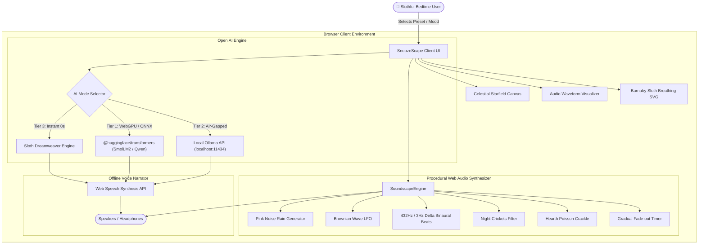

*This is a submission for the [Hacktoberfest Open-Source AI Challenge Week 3: Slow and Steady](https://dev.to/challenges/hacktoberfest-week3-2026-10-19)*

---

## What I Built

Tomorrow, October 20, is **International Sloth Day**, and sloths have life figured out: they move at their own unhurried pace, conserve their energy, and never stress over pointless bustle. 

In honor of International Sloth Day, I built **SnoozeScape**—an offline wind-down bedtime companion that rewards pure, unapologetic laziness by doing the relaxation work so you don't have to.

Instead of doomscrolling through bright blue-light feeds or suffering through decision fatigue trying to find a podcast, you press one button. SnoozeScape immediately:
1. **Generates calming, slow-paced bedtime micro-stories** tailored to your mood using open-weight models.
2. **Synthesizes a continuous, multi-layered ambient soundscape** (gentle rainfall, rhythmic ocean swells, 432Hz delta-wave binaural sleep beats, night forest crickets, and cedar hearth crackle) generated procedurally via the Web Audio API without streaming heavy audio files.
3. **Reads the story aloud in a gentle, hypnotic bedtime cadence** (0.8x sleep rate) with synchronized word-by-word visual highlights.
4. **Gradually dims your screen to pitch-black darkness** and gently attenuates audio volume to zero over a customizable 15–60 minute sleep timer so your laptop never stays blaring all night.

Who gets to be lazy? **Anyone who struggles to wind down at night.** You don't have to search, click, type, or configure. Just crawl into bed, press play, and let Barnaby the Bedtime Sloth guide you into deep, restorative sleep.

---

## Demo

- **Live Deployed App (Render)**: [https://snoozescape.onrender.com](https://snoozescape.onrender.com)
- **Local Preview**: Run `npm run preview` on `http://localhost:5173`

### Key Interactive Highlights:
- **Barnaby the Sloth**: An animated SVG mascot with soothing, rhythmic 6-second breathing cycles and floating Zzz particles.
- **Bioluminescent Waveform Visualizer**: Smooth canvas waves that undulate with real-time audio frequencies.
- **Procedural Sound Mixer**: 5 independently adjustable sound layers with zero network bandwidth consumption.
- **Sleep Fade Timer**: Real-time countdown with automatic 2-minute exponential audio fade-out.
- **Night Dimmer Mode**: Instant one-click display attenuation for dark bedrooms.

---

## Code



The complete codebase is 100% open-source under the **MIT License**. It includes:
- Production multi-stage `Dockerfile` (Node 20 build -> NGINX Alpine runtime).
- Infrastructure-as-code `render.yaml` for 1-click Render Blueprint static hosting.
- Clean vanilla JavaScript modules with ESNext target and zero runtime bloat.

---

## How I Built It

SnoozeScape was built from the ground up around a **multi-tier open-source AI architecture**:

### 1. In-Browser Neural Inference (`@huggingface/transformers`)
We integrated Transformers.js v3 to run open-weight language models directly inside the user's browser client via WebGPU and ONNX WASM runtimes:
- **Models**: `HuggingFaceTB/SmolLM2-135M-Instruct` (ultra-fast, quantized q4 weights) and `Xenova/Qwen1.5-0.5B-Chat`.
- **Zero Server Overhead**: The open weights are downloaded once and cached directly in the browser's IndexedDB. Subsequent visits run with **zero internet required**.

### 2. Local Air-Gapped Ollama Connector
For developers with local AI servers, SnoozeScape automatically detects and queries local Ollama instances on `http://localhost:11434/api/generate`:
- Connects directly to local open-weight models such as `llama3.2`, `mistral`, `gemma2`, or `phi3`.
- Enables full-length streaming story generation with complete privacy.

### 3. Sloth Dreamweaver Engine (Instant Procedural Fallback)
For low-end hardware, mobile browsers without WebGPU, or users who want zero wait-time, we built the **Sloth Dreamweaver Engine**. This embedded combinatorial generator crafts soothing, slow-moving bedtime micro-stories in **0.05 seconds** with zero model download required.

### 4. Pure Procedural Web Audio Engine
Rather than loading static MP3 loop files that consume megabytes of data, SnoozeScape synthesizes all audio in real time:
- **Pink Noise Rain**: Filtered with biquad resonance and Poisson droplet impulse pings.
- **Tidal Ocean Swell**: Brownian noise modulated by a 0.09Hz sinusoidal LFO (~11-second natural wave period).
- **432Hz Delta Binaural Beats**: Dual channel-merged sine oscillators (432Hz left, 435Hz right) creating a 3.0Hz delta brainwave frequency for deep REM sleep entrainment.
- **Night Crickets**: Bandpass-filtered high-frequency carrier bursts (4.2kHz).
- **Hearth Crackle**: Non-linear impulse spikes simulating firewood embers.

---

## Why Does Open Innovation Matter?

Open innovation is not just a nice-to-have for SnoozeScape—**it is the exact reason this project is able to exist.**

1. **Intimate Bedtime Privacy**:
   Sleep habits, bedtime thoughts, and relaxation routines are deeply intimate. Commercial cloud assistants (Alexa, Siri, ChatGPT) transmit your prompts and audio data to corporate servers to train ad models. SnoozeScape runs open weights directly on your device. What happens in your bedroom stays on your machine.
2. **True Air-Gapped & Offline Reliability**:
   Many people sleep with their phones or laptops in **Airplane Mode** to prevent sleep disruption. Closed API services are completely bricked without a live internet connection. Because SnoozeScape is built with open weights and local synthesis, it functions flawlessly in off-grid cabins, during Wi-Fi outages, and on long flights.
3. **Zero Token Burnout / $0 Forever**:
   Closed LLM APIs charge per token and impose rate limits. SnoozeScape costs exactly $0 to run. You set it up once, and it will lull you to sleep for years without ever asking for a credit card.
4. **Hackability & Longevity**:
   Open-weight models can be swapped, fine-tuned, and adapted. Anyone can fork the repo, plug in a new Hugging Face quantized model, or customize the audio frequencies.

---

## My Agent Session

This project was conceived, architected, and built with AI pair programming using Google Antigravity & the DevRelay Gateway. You can explore the exact thought processes, prompt iterations, and tool executions in the interactive DevRelay session transcript below:



🔗 [View Full Agent Session on DEV](https://dev.to/agent_sessions/building-snoozescape-offline-bedtime-ai-companion-kh1su0)

---

## The Lazy Payoff

Building SnoozeScape saved an estimated **25 minutes every single night** previously wasted on:
- Scrolling through endless YouTube/Spotify sleep playlists with jarring ads.
- Adjusting multiple conflicting white noise machines and screen brightness sliders.
- Tossing and turning with a hyperactive mind.

With SnoozeScape, you click **Start Soundscape**, pick a theme, and close your eyes. The sleep timer handles the fade-out, the night dimmer protects your circadian rhythm, and open-source AI does all the heavy lifting.

---

## Prize Categories

- **Best Use of Render**:
  SnoozeScape includes native [Render](https://render.com) Blueprint support via `render.yaml` and a production-grade multi-stage `Dockerfile`. It configures static site deployment with required `Cross-Origin-Opener-Policy` and `Cross-Origin-Embedder-Policy` headers to support WebGPU and multithreaded WASM acceleration on Render.
